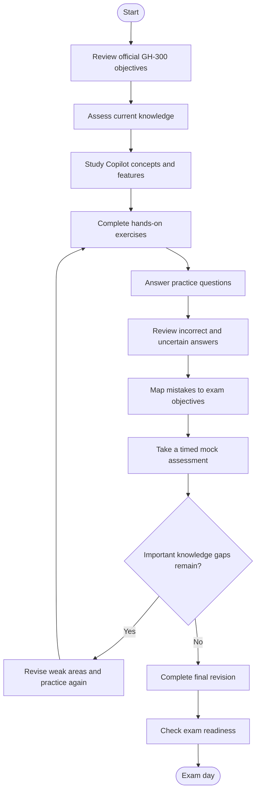
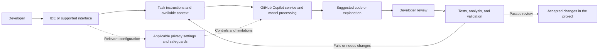
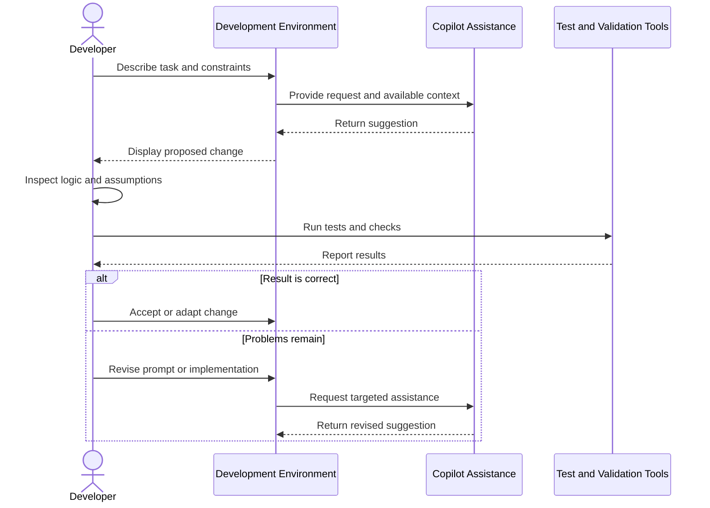
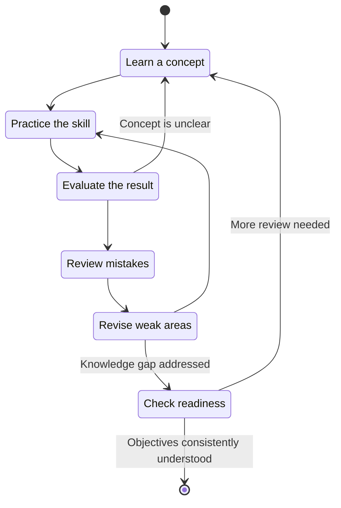
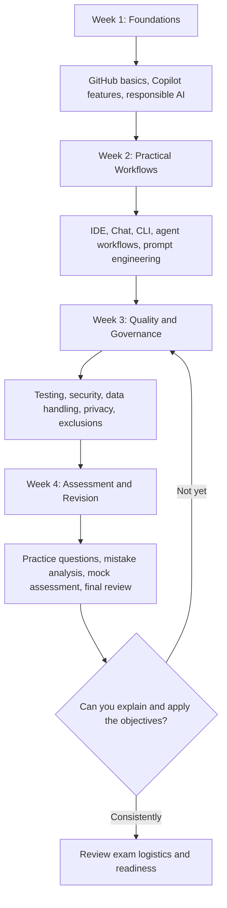

# GH-300: GitHub Copilot — Study Guide and Exam Preparation

A practical, community-oriented study guide for **GH-300: GitHub Copilot**, focused on responsible AI-assisted development, Copilot features, prompt engineering, developer productivity, data handling, and privacy safeguards.

This repository brings together official learning resources, technical diagrams, hands-on exercises, review questions, and a structured preparation roadmap to help learners study the exam objectives systematically.

- Official certification page: [GitHub Copilot certification](https://learn.microsoft.com/en-us/credentials/certifications/github-copilot/)
- Official study guide: [GH-300 skills measured](https://learn.microsoft.com/en-us/credentials/certifications/resources/study-guides/gh-300)
- Independent preparation resource: [CertsGate](https://certsgate.com/)

---

## Table of Contents

- [Overview](#overview)
- [About the GH-300 Certification](#about-the-gh-300-certification)
- [Who Should Prepare?](#who-should-prepare)
- [Exam Details](#exam-details)
- [Official Exam Objectives](#official-exam-objectives)
- [Skills Map and Domain Weightings](#skills-map-and-domain-weightings)
- [Certification Preparation Flowchart](#certification-preparation-flowchart)
- [GitHub Copilot Conceptual Architecture](#github-copilot-conceptual-architecture)
- [How a Copilot-Assisted Development Workflow Works](#how-a-copilot-assisted-development-workflow-works)
- [Circular Study and Revision Cycle](#circular-study-and-revision-cycle)
- [Step-by-Step GH-300 Preparation Guide](#step-by-step-gh-300-preparation-guide)
- [Suggested Study Roadmap](#suggested-study-roadmap)
- [Practice Questions](#practice-questions)
- [Hands-On Projects and Exercises](#hands-on-projects-and-exercises)
- [Common Preparation Mistakes](#common-preparation-mistakes)
- [Certification Benefits and Career Relevance](#certification-benefits-and-career-relevance)
- [Frequently Asked Questions](#frequently-asked-questions)
- [Official and Additional Learning Resources](#official-and-additional-learning-resources)
- [About CertsGate](#about-certsgate)

---

## Overview

GitHub Copilot is an AI-powered development assistant that can help developers understand code, generate suggestions, write tests, refactor existing implementations, document software, and work through development tasks.

Using an AI coding assistant effectively involves more than accepting generated code. Developers must understand how to provide useful context, evaluate suggestions, recognize limitations, protect sensitive information, and verify that the resulting software behaves correctly.

The **GH-300 study guide** is designed around these practical skills. It covers responsible AI use, Copilot features and workflows, data architecture, prompt engineering, productivity, and privacy safeguards.

This repository is intended to help learners:

- Organize preparation around the published GH-300 exam objectives.
- Understand how GitHub Copilot fits into a software development workflow.
- Practice writing precise prompts and supplying relevant context.
- Evaluate generated code for correctness, maintainability, security, and edge cases.
- Understand organizational controls, content exclusions, and responsible AI principles.
- Identify knowledge gaps through practice questions and review exercises.

Use this guide alongside the official [GH-300 study guide](https://learn.microsoft.com/en-us/credentials/certifications/resources/study-guides/gh-300). For additional independent preparation materials, visit [CertsGate](https://certsgate.com/).

## About the GH-300 Certification

GH-300 is the exam associated with the **GitHub Copilot** certification available through Microsoft's certification platform.

The certification evaluates knowledge of using GitHub Copilot to improve software development productivity, quality, and security while applying responsible AI practices.

Candidates should be comfortable with GitHub fundamentals and at least one programming language. Practical experience with an IDE, code review, testing, debugging, and software development workflows will make the subject matter easier to understand.

### Exam Details

| Item | Information |
|---|---|
| Exam code | GH-300 |
| Exam name | GitHub Copilot |
| Certification platform | Microsoft Learn |
| Published level | Intermediate |
| Exam duration | 100 minutes |
| Passing score | 700 or greater |
| Delivery | Proctored exam |
| Possible question experience | May include interactive components |
| Languages | English, Spanish, Portuguese (Brazil), Korean, and Japanese |
| Exam fee | Varies by country or region |
| Recommended background | GitHub fundamentals and experience with one or more programming languages |

Check the [official certification page](https://learn.microsoft.com/en-us/credentials/certifications/github-copilot/) for current exam policies, languages, pricing, scheduling, and other requirements. Microsoft does not establish a fixed question count in the study guide linked above, so this repository does not assume one.

## Who Should Prepare?

GH-300 preparation may be useful for:

- **Software developers** who use AI-assisted coding in everyday development.
- **Application developers** who want to use Copilot for code generation, refactoring, documentation, and tests.
- **DevOps engineers** interested in AI-assisted scripting and development workflows.
- **Technical leads and reviewers** who need to evaluate generated code and establish review practices.
- **Engineering managers and administrators** who work with organizational Copilot policies and responsible AI use.
- **Learners exploring AI-assisted software development** who already understand basic programming concepts.

The exam is not a substitute for programming knowledge. Understanding the code being generated is essential to validating suggestions and identifying unsafe or incorrect implementations.

## Official Exam Objectives

The current official study guide lists seven skill areas. Use the linked Microsoft documentation as the authoritative checklist because the scope and wording of objectives can change.

### 1. Use GitHub Copilot Responsibly — 15–20%

Study:

- Risks and limitations of generative AI tools.
- Ethical and responsible AI usage.
- Potential harms and strategies for mitigating them.
- The need to validate AI-generated output.
- Responsible operation of GitHub Copilot.

**Practical focus:** Explain why generated code needs human review, testing, and security checks even when it looks convincing.

### 2. Use GitHub Copilot Features — 25–30%

Study:

- Enabling Copilot in an integrated development environment (IDE).
- Inline suggestions and Copilot Chat.
- Copilot CLI and its interactive workflows.
- Agent mode and related development capabilities.
- Copilot Edits and supported development workflows.
- Model Context Protocol (MCP) and relevant integrations.
- Agent sessions, sub-agents, and context usage.
- Code review, coding assistance, Spaces, Spark, and pull request summaries.
- Instruction files and reusable prompt files.
- Organization-wide policies, audit events, and subscription management through the REST API.
- Content exclusions for applicable files or repositories.

**Practical focus:** Understand which feature fits a task, how to provide it with context, and how administrators can control availability.

### 3. GitHub Copilot Features and Capabilities — 25–30%

The official study guide's skills-at-a-glance section lists a second feature-related category with the same 25–30% range. The detailed section structure and category naming should be checked directly in the latest official guide rather than inferred from this summary.

Review the full [GH-300 study guide](https://learn.microsoft.com/en-us/credentials/certifications/resources/study-guides/gh-300) to ensure you understand how the currently published feature objectives are organized.

### 4. Understand GitHub Copilot Data and Architecture — 10–15%

Study:

- Data usage, flow, and sharing.
- Input processing and prompt construction.
- Proxy filtering and post-processing.
- The lifecycle of a code suggestion.
- Limitations of large language models (LLMs) and Copilot.

**Practical focus:** Trace how a developer's request and contextual information can influence a generated suggestion, and identify where validation is needed.

### 5. Apply Prompt Engineering and Context Crafting — 10–15%

Study:

- Prompt structure and context.
- How relevant context is determined.
- Zero-shot and few-shot prompting.
- Prompt-writing best practices.
- Prompt engineering principles.
- Prompt processing and chat history.

**Practical focus:** Write prompts that clearly state the task, constraints, expected behavior, relevant files, and acceptance criteria.

### 6. Improve Developer Productivity with GitHub Copilot — 10–15%

Study:

- Code generation and refactoring.
- Documentation and code explanation.
- Learning unfamiliar code and reducing context switching.
- Sample data generation and legacy-code modernization.
- Unit and integration test generation.
- Edge cases and assertions.
- Security improvements and performance optimization.

**Practical focus:** Use Copilot to accelerate a task without treating generated output as automatically correct.

### 7. Configure Privacy, Content Exclusions, and Safeguards — 10–15%

Study:

- Privacy settings and editor configuration.
- Content exclusions and their limitations.
- Ownership considerations for generated output.
- Public-code matching filters.
- Troubleshooting suggestions and exclusion behavior.

**Practical focus:** Understand how settings and organizational policies affect use, and verify the current documentation for plan-specific behavior.

> **Blueprint note:** The published skill ranges are percentage ranges rather than exact point allocations. They should not be converted into exact percentages or added into a pie chart as though they were single values. The two feature-related entries also need to be interpreted using the detailed official guide, not silently renamed or merged.

## Skills Map and Domain Weightings

The following diagram is a **conceptual study map**, not an official exam-weighting chart. It connects the topics learners should understand without assigning invented numerical values.

```mermaid
flowchart TD
    GH["GH-300: GitHub Copilot"]
    GH --> R["Responsible AI"]
    GH --> F["Copilot Features"]
    GH --> A["Data and Architecture"]
    GH --> P["Prompt Engineering"]
    GH --> D["Developer Productivity"]
    GH --> S["Privacy and Safeguards"]

    R --> R1["Validate outputs"]
    R --> R2["Recognize AI limitations"]

    F --> F1["IDE, Chat, CLI"]
    F --> F2["Agents, edits, code review"]
    F --> F3["Organization policies"]

    A --> A1["Input and context"]
    A --> A2["Suggestion lifecycle"]
    A --> A3["Filtering and processing"]

    P --> P1["Clear task and constraints"]
    P --> P2["Relevant context"]
    P --> P3["Zero-shot and few-shot"]

    D --> D1["Code and documentation"]
    D --> D2["Tests and refactoring"]
    D --> D3["Security and performance"]

    S --> S1["Content exclusions"]
    S --> S2["Privacy settings"]
    S --> S3["Public-code filtering"]
```



For the exact published domain ranges, refer to the [official skills-at-a-glance section](https://learn.microsoft.com/en-us/credentials/certifications/resources/study-guides/gh-300#skills-measured-as-of-august-7-2026). Recheck it before scheduling the exam.

## Certification Preparation Flowchart

Preparation should combine official objectives, conceptual learning, practical use, and deliberate review. Revisit topics when practice results reveal gaps instead of moving forward simply to finish a schedule.



## GitHub Copilot Conceptual Architecture

This diagram represents a simplified, conceptual workflow for AI-assisted development. It is an educational model, not a claim that every Copilot feature uses identical internal components or processing steps.



### How to Read the Diagram

1. A developer starts with a task in a supported interface.
2. The request and available context influence the assistance provided.
3. Copilot generates a suggestion or response.
4. The developer evaluates its correctness, relevance, and safety.
5. Tests and other validation methods help establish whether the change is suitable.
6. Incorrect or incomplete results lead to revised context, code, or prompts.

The real implementation depends on the feature, environment, plan, settings, and applicable policies. For product-specific details, read [How GitHub Copilot works and handles data](https://docs.github.com/en/copilot/concepts/about-copilot/how-github-copilot-works).

## How a Copilot-Assisted Development Workflow Works

A common learning exercise is to ask Copilot to help implement a small function and then validate the result.



This process illustrates an important exam theme: AI assistance can reduce repetitive work, but developers remain responsible for reviewing and validating the result.

## Circular Study and Revision Cycle

GH-300 preparation works best as an iterative process. Repeating questions without analyzing mistakes can reinforce misunderstandings. Instead, connect every weak result to a specific objective or practical skill.



## Step-by-Step GH-300 Preparation Guide

### Step 1: Read the Official Study Guide

Begin with the [GH-300 study guide](https://learn.microsoft.com/en-us/credentials/certifications/resources/study-guides/gh-300).

Turn every objective into a checklist. Mark each item as:

- **Not started:** The topic is unfamiliar.
- **Learning:** You understand the basic idea but need practice.
- **Practiced:** You have applied the concept and can explain it.
- **Needs review:** You still make mistakes or cannot explain the reasoning.

Use the full objective wording to avoid missing a topic because of a broad section heading.

### Step 2: Build a Working Knowledge of Copilot

Use Copilot in a project you understand. Explore its supported interfaces and features, such as inline suggestions, Chat, CLI, and agent-based workflows, where available.

For each feature, be able to explain:

- What task it helps with.
- What information or context it needs.
- What limitations it has.
- How to check the quality of its output.
- Which settings or organizational controls may apply.

Because Copilot capabilities evolve quickly, verify feature availability and behavior in the current official documentation rather than relying on old screenshots or memorized menu paths.

### Step 3: Practice Prompt Engineering

A useful prompt usually includes a task, context, constraints, and a clear definition of the expected result.

For example:

```text
Task:
Write unit tests for the validate_email function.

Context:
The function is in validation.py and accepts a string.

Requirements:
- Cover valid and invalid email-like inputs.
- Include empty input and boundary cases.
- Use the project's existing test framework.
- Do not modify the function implementation.

Output:
Provide the proposed tests and briefly explain the cases covered.
```

This is an illustrative prompt, not an official exam question. Its purpose is to demonstrate how a precise task and explicit constraints can make the result easier to evaluate.

Practice refining vague requests, supplying relevant context, and asking for explanations or tests when they help you validate an answer.

### Step 4: Understand Responsible AI and Limitations

Study why an AI-generated suggestion may be:

- Syntactically correct but logically wrong.
- Inconsistent with the surrounding codebase.
- Missing error handling or edge cases.
- Inefficient or difficult to maintain.
- Insecure or inappropriate for the intended environment.
- Based on assumptions that were never specified.

Learn to treat suggestions as proposals. Review code, run tests, check dependencies, and follow your organization's security and review practices.

### Step 5: Learn Data Handling and Privacy Controls

Review the official documentation on how Copilot processes information and how relevant settings affect its behavior.

Be prepared to explain the purpose and limitations of content exclusions, public-code matching filters, privacy settings, and organizational policies. Avoid assuming that a setting has identical behavior across all plans, IDEs, or features.

### Step 6: Use Practice Questions Deliberately

Practice questions can help identify topics that need more work, but a score alone does not demonstrate understanding.

For each question:

1. Choose an answer and explain why it fits.
2. Explain why the alternatives are less appropriate.
3. Find the related objective in the official study guide.
4. Revisit documentation or a hands-on exercise if your reasoning was weak.
5. Try a new scenario to check whether you can apply the concept.

You can use Microsoft's official practice assessment and independent resources such as [CertsGate](https://certsgate.com/) to complement your learning.

### Step 7: Prepare for the Exam Experience

Review Microsoft's [exam sandbox](https://ghcertdemo.starttest.com/) to familiarize yourself with the testing interface. Check the official certification page for current exam duration, policies, languages, accommodations, and scheduling details.

## Suggested Study Roadmap

The following is an **illustrative four-week schedule**, not a Microsoft-mandated study plan. Adjust it to your existing programming experience, familiarity with GitHub Copilot, and available time.



### Weekly Study Targets

| Week | Main focus | Suggested activity |
|---|---|---|
| 1 | Official objectives, Copilot fundamentals, responsible AI | Create an objective checklist and explore core workflows |
| 2 | IDE, Chat, CLI, agents, context, prompt engineering | Complete small coding and explanation exercises |
| 3 | Testing, security, privacy, data flow, governance | Review generated code and examine settings and safeguards |
| 4 | Assessment and revision | Analyze mistakes, revisit weak objectives, and use the exam sandbox |

Spend more time on topics you cannot explain clearly. Do not treat completion of the schedule as proof of readiness.

## Practice Questions

These original practice questions are designed to reinforce relevant concepts. **They are illustrative learning exercises, not official Microsoft questions and not predictions of the actual exam.**

### Question 1: Validating Generated Code

A developer asks Copilot to generate a function. The suggestion looks correct, but it has not been tested. What is the most appropriate next step?

A. Accept it because the syntax looks valid.  
B. Review the logic and test it against the requirements and edge cases.  
C. Assume Copilot has already checked its security.  
D. Remove the existing tests to avoid conflicting results.

**Answer: B**

**Explanation:** Generated code needs human review and validation. Tests, edge-case analysis, and security checks help reveal problems that may not be obvious from syntax alone.

### Question 2: Improving a Vague Prompt

A developer asks, "Make this code better," and receives a broad response. Which change is most likely to make the request more useful?

A. Repeat the same request several times.  
B. Remove all information about the intended behavior.  
C. Specify the goal, relevant context, constraints, and expected output.  
D. Ask Copilot to make every possible improvement without limits.

**Answer: C**

**Explanation:** A clear task and relevant context help focus the response and make the result easier to evaluate.

### Question 3: Responsible AI

Copilot suggests a database query that appears to work but may expose data beyond the intended user's permissions. What should the developer do?

A. Deploy it because the query runs successfully.  
B. Ask Copilot to confirm that the query is safe and deploy immediately.  
C. Review the authorization requirements, inspect the query, and test the relevant access cases.  
D. Assume that AI-generated queries always follow application security rules.

**Answer: C**

**Explanation:** Functional behavior alone does not establish security. Developers must validate authorization logic and test relevant scenarios.

### Question 4: Privacy and Content Exclusions

An organization needs to understand whether particular files can be excluded from Copilot-related context. What is the most appropriate approach?

A. Assume one exclusion setting applies identically to every feature and plan.  
B. Review the current official content-exclusion documentation and verify the applicable feature and configuration limitations.  
C. Assume private repositories never need privacy controls.  
D. Disable code review for the entire organization without checking the requirement.

**Answer: B**

**Explanation:** Product behavior and limitations can vary. Current official documentation is the appropriate source for configuration-specific decisions.

### Question 5: Reviewing Practice Results

A learner repeatedly misses questions about the Copilot suggestion lifecycle. What should the learner do next?

A. Memorize the answer letters and continue.  
B. Ignore the results if the overall score is acceptable.  
C. Map the mistakes to the official objective, study the underlying concept, and practice it again.  
D. Study unrelated topics instead.

**Answer: C**

**Explanation:** Practice is most valuable when it reveals a specific knowledge gap that can be addressed and reassessed.

## Hands-On Projects and Exercises

Practical exercises help connect exam terminology with actual development work. Use a repository and environment you are authorized to work in. Avoid using confidential code or sensitive information in ways that violate your organization's policies.

### Project 1: Code Generation and Refactoring

**Goal:** Understand how Copilot can assist with implementation and code improvement.

Tasks:

1. Choose a small function with clear requirements.
2. Ask Copilot to implement or refactor it.
3. Inspect the result for correctness and maintainability.
4. Add tests for normal cases, invalid inputs, and edge cases.
5. Compare the proposed implementation with your original version.

**Learning outcome:** Practice code generation, context crafting, refactoring, and validation.

### Project 2: Test Generation

**Goal:** Use Copilot to support test development.

Tasks:

1. Choose a function with defined behavior.
2. Request unit tests that cover expected inputs and edge cases.
3. Check whether the tests make meaningful assertions.
4. Run the tests.
5. Add cases for failures the generated tests overlooked.

**Learning outcome:** Understand how generated tests can help and why human review remains necessary.

### Project 3: Prompt Refinement

**Goal:** Compare broad prompts with structured prompts.

Tasks:

1. Ask Copilot to explain an unfamiliar function using a short prompt.
2. Repeat with relevant context and specific questions.
3. Compare clarity, relevance, and completeness.
4. Record which instructions made the biggest difference.
5. Try zero-shot and few-shot prompting where appropriate.

**Learning outcome:** Improve prompt engineering and context selection.

### Project 4: Security and Code Review

**Goal:** Evaluate AI assistance without treating it as a security guarantee.

Tasks:

1. Select a small example with a known validation or authorization requirement.
2. Ask Copilot to review the implementation.
3. Inspect the recommendations independently.
4. Add or run tests for relevant failure cases.
5. Document any incorrect or incomplete suggestions.

**Learning outcome:** Practice responsible AI use, security reasoning, and code review.

### Project 5: Privacy and Organization Controls

**Goal:** Understand governance-related exam topics.

Tasks:

1. Read the current documentation for content exclusions and privacy settings.
2. Identify which settings are relevant to your chosen plan and environment.
3. Review how organization policies and audit events are documented.
4. Summarize the purpose and limitations of the controls.
5. Do not assume a feature is available unless the current documentation confirms it.

**Learning outcome:** Connect privacy, configuration, and responsible use with real development environments.

## Common Preparation Mistakes

### Memorizing Features Without Understanding Their Purpose

Learn what a feature does, when it is useful, and what limitations matter. Product names and menu locations can change.

### Accepting AI Output Without Validation

A convincing explanation or plausible code sample is not proof of correctness. Review logic, tests, security, and maintainability.

### Using Vague Prompts

Unclear requests can produce broad or irrelevant suggestions. Practice defining the task, context, constraints, and expected result.

### Ignoring Privacy and Safeguards

Do not treat privacy controls and content exclusions as minor administrative details. They are explicit areas of the published exam outline.

### Practicing Questions Without Reviewing Mistakes

A practice score is useful only when it informs what to study next. Investigate incorrect answers and answers selected through guesswork.

### Relying on Outdated Product Screenshots

GitHub Copilot evolves frequently. Use current official documentation to verify interfaces, plan-specific features, and settings.

### Treating a Mock Score as a Guarantee

Practice assessments can help reveal gaps, but no practice result guarantees success on the certification exam.

## Certification Benefits and Career Relevance

Knowledge covered by GH-300 can be relevant to developers and technical teams adopting AI-assisted software development.

Useful capabilities include:

- Integrating AI assistance into everyday development workflows.
- Writing clearer prompts and providing useful context.
- Reviewing and testing AI-generated code.
- Using AI support for refactoring, documentation, and test generation.
- Recognizing limitations and potential risks of generative AI.
- Understanding privacy controls and organizational policies.

The certification may help demonstrate knowledge of GitHub Copilot, but its value depends on the role, practical ability, and expectations of the employer. It does not replace programming experience, secure engineering practices, or the ability to maintain production software.

## Frequently Asked Questions

### What is GH-300?

GH-300 is the GitHub Copilot certification exam listed on Microsoft's certification platform. Its published objectives cover responsible AI, Copilot features, data and architecture, prompt engineering, developer productivity, privacy, and safeguards.

### What is the passing score for GH-300?

The official study guide states that a score of **700 or greater** is required to pass. Check Microsoft's current exam documentation for the scoring policy and any updated information.

### How long is the GH-300 exam?

The current certification page lists **100 minutes**. The exam is proctored and may include interactive components.

### How many questions are on GH-300?

Do not rely on unofficial claims about a fixed question count. The official study guide used for this repository does not publish one. Check Microsoft's exam information for current details.

### What should I study for GH-300?

Start with the official objectives and cover responsible AI, Copilot interfaces and capabilities, data handling, prompt engineering, developer productivity, privacy, and safeguards. Use the detailed official guide to track individual skills.

### Is programming experience useful for GH-300?

Yes. Microsoft recommends familiarity with GitHub fundamentals and experience with one or more programming languages. Practical development experience makes it easier to assess generated code and understand its limitations.

### Are the practice questions in this repository official?

No. The questions in this repository are original educational examples intended to help reinforce concepts. They are not represented as official, leaked, or actual exam questions.

### Where can I find official training?

Use Microsoft's [GH-300 study guide](https://learn.microsoft.com/en-us/credentials/certifications/resources/study-guides/gh-300), the [GitHub Copilot certification page](https://learn.microsoft.com/en-us/credentials/certifications/github-copilot/), and the official [GH-300 course](https://learn.microsoft.com/en-us/training/courses/gh-300t00).

### Can CertsGate replace official study materials?

CertsGate can be used as an independent supplementary preparation resource. Use it alongside official objectives, documentation, and hands-on practice rather than treating any third-party resource as a replacement for those materials.

### When should I schedule the exam?

Consider scheduling when you can explain the objectives, apply the concepts in practical exercises, review mistakes accurately, and perform consistently on practice assessments. Also review current exam policies and logistics before booking.

## Official and Additional Learning Resources

Use official resources for current exam requirements, product behavior, and technical documentation.

### Microsoft Certification Resources

- [GitHub Copilot Certification](https://learn.microsoft.com/en-us/credentials/certifications/github-copilot/) — exam details, assessment, scheduling, and certification information.
- [GH-300 Study Guide](https://learn.microsoft.com/en-us/credentials/certifications/resources/study-guides/gh-300) — published skills measured and study resources.
- [GH-300 Course](https://learn.microsoft.com/en-us/training/courses/gh-300t00) — official training course.
- [GitHub Copilot Exam Sandbox](https://ghcertdemo.starttest.com/) — familiarize yourself with the exam interface.
- [Microsoft Learn](https://learn.microsoft.com/) — official technical documentation and learning materials.

### GitHub Copilot Documentation

- [GitHub Copilot Documentation](https://docs.github.com/en/copilot) — features, configuration, and product guidance.
- [How GitHub Copilot Works](https://docs.github.com/en/copilot/concepts/about-copilot/how-github-copilot-works) — conceptual information about Copilot's operation and data handling.
- [Prompt Engineering for GitHub Copilot](https://docs.github.com/en/copilot/concepts/prompting/prompt-engineering) — guidance on crafting useful prompts.
- [Responsible AI at Microsoft](https://www.microsoft.com/en-us/ai/responsible-ai) — responsible AI principles and guidance.
- [GitHub Community Discussions](https://github.com/orgs/community/discussions) — community questions and discussion.

## About CertsGate

[CertsGate](https://certsgate.com/) is an independent website offering IT certification preparation resources across different technology providers.

Candidates preparing for GH-300 may use relevant study materials and practice questions as supplementary tools to review concepts and identify areas that need more attention.

A balanced preparation approach combines:

1. The official GH-300 exam objectives.
2. Microsoft and GitHub technical documentation.
3. Practical experience using GitHub Copilot.
4. Independent practice questions and mock assessments.
5. Review of incorrect answers and weak areas.

**Use this repository to guide your learning, strengthen your practical understanding, and identify areas for further study—not as a guarantee of exam results.**
